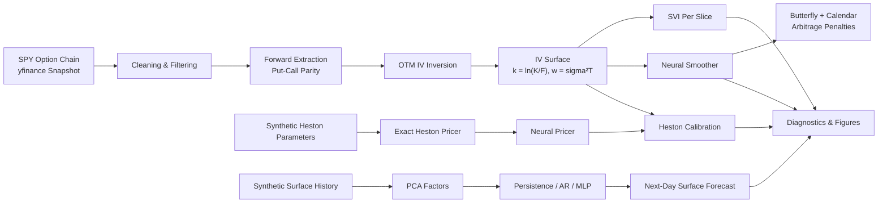

# Neural Volatility Surface


Builds an implied-volatility surface from a real SPY option-chain snapshot, then applies neural methods to:

- smooth the surface while enforcing no-arbitrage constraints,
- calibrate a Heston stochastic-volatility model with a neural pricer, and
- forecast surface evolution in a controlled synthetic setting.

The project combines quantitative finance, numerical option pricing, optimization, and neural networks in a reproducible CPU-only research pipeline.

See `PRD.md` for the project scope and `docs/progress.md` for the milestone-by-milestone development log.

## Real vs. synthetic data

**Read this distinction before interpreting the results.** The project deliberately separates market-derived results from synthetic experiments.

| Component | Data | Interpretation |
|---|---|---|
| Surface construction | **Real** SPY option-chain snapshot from yfinance | Market-observed snapshot |
| SVI fitting | **Real** snapshot | Surface reconstruction |
| Neural smoother | **Real** snapshot | Surface smoothing and arbitrage diagnostics |
| Heston calibration | **Real** snapshot | Model calibration against observed IVs |
| Neural pricer training | **Synthetic** exact Heston prices | Controlled pricing approximation |
| Neural pricer error table | **Synthetic** held-out Heston parameter sets | Pricing approximation accuracy |
| Forecaster (Track C) | **Synthetic only** latent Heston dynamics + quote noise | Methodology experiment; **not a real-market forecast** |

The repository includes a daily snapshot collector at `scripts/collect_snapshot.py`. Scheduling it allows a real historical dataset to accumulate over time. See `docs/data_sources.md` for data-source details.

## Architecture



## Quick start

Requires **Python 3.11** and `uv`. The pipeline is designed to run on CPU.

```bash
make setup
make fetch
make surface
make train-pricer
make calibrate
make smooth
make forecast
make test
make lint
python scripts/run_all.py [--skip-fetch] [--skip-train]
```

Outputs are written to `results/figures/`, `results/tables/`, and `results/models/`. Interactive 3D figures are saved as `*.html` and load Plotly.js from a CDN.

### Reproducibility note

`make fetch` downloads the market as it exists at execution time. Therefore, rerunning the pipeline reproduces the **method and workflow**, not the exact market numbers reported below.

The reported real-data snapshot is dated **2026-11-07** and represents Friday's close because that date was a Saturday.

## Methodology

### 1. Option-chain cleaning

The raw option chain is filtered using explicit quality checks, with every rejection counted in the processing log:

- positive bid and ask,
- bid-ask spread ≤ 50%,
- mid price ≥ $0.05,
- open interest ≥ 10,
- stale quotes with no volume removed.

The reported pipeline reduced:

`6,141 raw quotes → 4,483 cleaned quotes → 2,931 OTM quotes`

with **0 IV inversion failures**.

### 2. Forward extraction

For each expiry, the forward is estimated from the 12 put-call pairs nearest spot using put-call parity.

The discount factor is:

`DF = exp(-rT)`

with a fixed **4% rate**. The free-slope parity fit was considered too noisy, so the forward absorbs dividend/borrow effects.

The surface is represented in log-moneyness `k = ln(K/F)` and total variance `w = σ²T`.

### 3. Implied-volatility inversion

OTM option mids are inverted to implied volatility after checking pricing bounds. The solver uses safeguarded Newton iterations, bisection fallback when necessary, and repricing to verify the recovered IV.

### 4. Heston pricing

The Heston implementation uses a characteristic function in little-trap form, Lewis integration, and Gauss-Legendre quadrature. It was checked against the Fang-Oosterlee (2008) benchmark and an independent quadrature implementation.

### 5. Neural Heston pricer

An MLP learns the mapping `Heston parameters → implied volatility` on a fixed **9 × 6 (`k` × `T`) grid** defined in `configs/default.yaml`.

Training labels are generated from the exact Heston pricer. The neural model is evaluated on held-out parameter sets to measure approximation error.

### 6. Neural surface smoother

A second MLP maps `(k, T) → IV` while incorporating differentiable no-arbitrage penalties:

- **Butterfly arbitrage:** Gatheral `g ≥ 0`
- **Calendar arbitrage:** `dw/dT ≥ 0`

The model is compared against raw interpolation and per-slice SVI.

### 7. Surface forecasting

The forecasting experiment compares persistence, autoregression on PCA factors, and an MLP on lagged PCA factors. Evaluation uses expanding-window walk-forward validation with no shuffling.

Importantly, this track uses **synthetic history only** because the project does not have a real historical option-surface dataset.

## Key results

All results below come from the reported **2026-11-07 SPY snapshot** unless explicitly marked synthetic. Detailed tables are stored under `results/tables/`.

### Neural pricer vs. exact Heston

**5,000 held-out synthetic parameter sets; error measured in volatility points.**

| Region | Mean | P95 | Max |
|---|---:|---:|---:|
| All | 0.0055 | 0.016 | 1.32 |
| ATM (`abs k <= 0.04`) | 0.0044 | 0.013 | 0.49 |
| Wings (`abs k >= 0.14`) | 0.0068 | 0.019 | 1.32 |
| Short maturity (`T <= 0.10y`) | 0.0072 | 0.020 | 1.32 |
| Long maturity (`T >= 0.75y`) | 0.0048 | 0.014 | 0.53 |
| Wings + short maturity | 0.0097 | 0.027 | 1.32 |

The average approximation error is well below one volatility point. The largest single error occurs in the **wing / short-maturity** region.

### Heston calibration to the real surface

**41 of 54 grid cells covered by market data; 8 shared optimizer restarts.**

| Pricer | v0 | κ | v̄ | σ | ρ | Grid RMSE (vol pts) | Total time | Per evaluation |
|---|---:|---:|---:|---:|---:|---:|---:|---:|
| Neural | 0.0571 | 3.62 | 0.0491 | 1.2 (bound) | -0.818 | 2.505 | 1.3 s | 0.10 ms |
| Exact | 0.0571 | 3.61 | 0.0492 | 1.2 (bound) | -0.818 | 2.505 | 7.1 s | 2.9 ms |

Both approaches converge to essentially the same optimum.

- **5.6× faster** end-to-end calibration.
- Approximately **28× faster per pricing evaluation** on CPU.
- The calibrated vol-of-vol parameter `σ = 1.2` reaches its upper bound.
- The **2.5-vol-point RMSE** indicates model misspecification, particularly Heston's difficulty matching the short-maturity skew.

### Neural smoother vs. SVI vs. raw interpolation

Evaluation window: `k ∈ [-0.15, 0.10]`, `T ∈ [0.05, 0.90]`, 101 × 40 evaluation grid.

| Method | RMSE (vol pts) | Butterfly violations | Calendar violations |
|---|---:|---:|---:|
| Raw interpolation | 0 | 101 | 2 |
| SVI per slice | 0.42 | 0 | 0 |
| Neural, no penalty | 0.34 | 0 | 0 |
| Neural, arbitrage penalties | 0.34 | 0 | 0 |

### Stress test

Using the same quotes with **synthetic 1.0-vol-point noise**:

| Method | Butterfly violations | Calendar violations | RMSE |
|---|---:|---:|---:|
| Raw interpolation | 1,921 | 237 | ~1.04 |
| SVI | 0 | 16 | ~1.05 |
| Neural, no penalty | 0 | 0 | ~1.04 |
| Neural, arbitrage penalties | 0 | 0 | ~1.06 |

The neural smoother fits slightly better than SVI and remains arbitrage-free in the reported noisy test. However, the explicit arbitrage penalty terms themselves make **no measurable difference** on this dataset.

### Surface forecasting — synthetic only

**1,000 walk-forward test days with 0.3-vol-point quote noise.**

| Model | RMSE (vol pts) | Ratio vs. persistence |
|---|---:|---:|
| Persistence | 0.621 | 1.00 |
| AR on PCA factors | 0.548 | 0.88 |
| MLP on PCA factors | 0.564 | 0.91 |

The AR model reduces error relative to persistence, while the MLP performs slightly worse than AR.

The reported improvement appears to come primarily from filtering quote noise and exploiting mean reversion in the synthetic process. **It should not be interpreted as evidence of predictive power in real option markets.**

## Visualizations

Generated figures are stored in `results/figures/`, including:

- `surface_svi_3d%%
- `surface_heston_3d%%
- `surface_neural_3d%%
- `smiles_*%%
- `term_structure_*%%
- `residuals_*%%
- `arbitrage_compare*%%
- `pricer_error_grid%%
- `forecast_synthetic%%

## Limitations

- **Single underlying, single snapshot:** only one delayed SPY snapshot is used for real-data analysis.
- **No real forecasting history:** Track C is synthetic because free sources do not provide the required historical option-surface dataset.
- **American options:** SPY options are American, while European pricing and put-call parity are used as an approximation.
- **Fixed discount rate:** the forward calculation uses a fixed 4% rate; dividend and borrow effects are absorbed by the estimated forward.
- **Heston misspecification:** Heston struggles with the steep short-maturity skew, particularly for `k < -0.15` and `T < 0.15y`.
- **Vol-of-vol boundary:** the calibrated Heston `σ` reaches the upper bound of 1.2.
- **Neural-pricer domain:** the pricer is trained only within the parameter box and fixed `k/T` grid defined by the configuration.
- **Worst-case neural error:** the maximum held-out pricer error is substantially larger than the mean, concentrated in the wing/short-maturity region.
- **Penalty contribution:** arbitrage penalties produced no measurable improvement over the unpenalized neural smoother on the tested data.
- **Finite-difference diagnostics:** butterfly counts depend on the evaluation grid and are therefore only indicative on the coarse 9-point forecast grid.
- **No Rough Bergomi:** the Rough Bergomi stretch goal from the PRD was not attempted.

## Reproducing the research

```bash
make setup
make fetch
make surface
make train-pricer
make calibrate
make smooth
make forecast
make test
make lint
```

To rerun the complete workflow while skipping expensive or unnecessary stages:

```bash
python scripts/run_all.py --skip-fetch --skip-train
```

Use the current market snapshot when you want fresh real-data results. To reproduce the exact numerical tables reported in this README, the original snapshot and generated artifacts would need to be preserved because the repository's live data collection intentionally updates with the market.

## Project structure

```text
Neural-Vol-Surface/
├── configs/                 # Experiment configuration
├── data/
│   ├── raw/                 # Downloaded snapshots (git-ignored)
│   └── processed/           # Cleaned/intermediate datasets
├── docs/
│   ├── data_sources.md      # Market-data provenance
│   └── progress.md          # Milestone log
├── results/
│   ├── figures/             # Plots and interactive visualizations
│   ├── models/              # Trained neural models
│   └── tables/              # Experiment results
├── scripts/
│   ├── collect_snapshot.py  # Daily SPY snapshot collector
│   └── run_all.py           # End-to-end pipeline
├── src/
│   └── nvs/
│       ├── surface/         # Surface construction and SVI
│       ├── nn/              # Neural pricer, smoother, forecaster
│       ├── calibrate.py     # Heston calibration
│       └── viz.py           # Visualization
├── tests/                   # Automated tests
├── Makefile
├── PRD.md
├── pyproject.toml
└── requirements.txt
```

## References

- Horvath, Muguruza, Tomas (2021), *Deep Learning Volatility*.
- Ackerer, Tagasovska, Vatter (2020), *Deep Smoothing of the Implied Volatility Surface*.
- Gatheral & Jacquier (2014), *Arbitrage-free SVI*.
- Heston (1993), *A Closed-Form Solution for Options with Stochastic Volatility*.
- Fang & Oosterlee (2008), numerical Fourier methods for option pricing.

## License

This project is licensed under the MIT License. See [LICENSE](LICENSE) for details.
